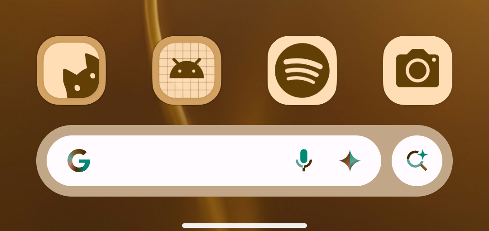
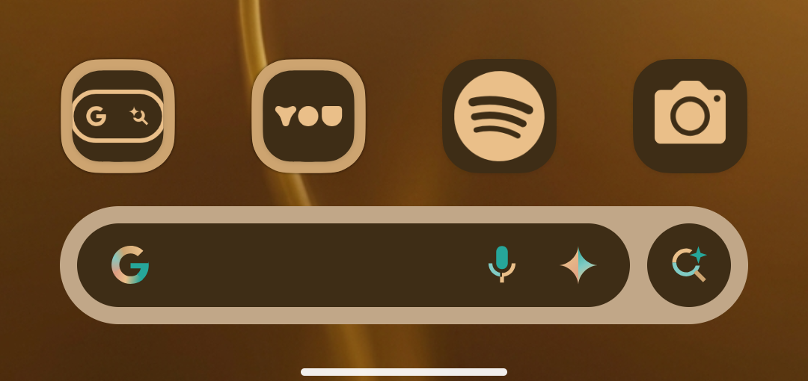
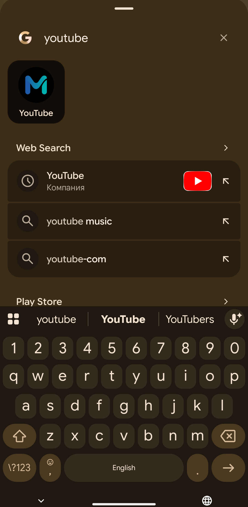
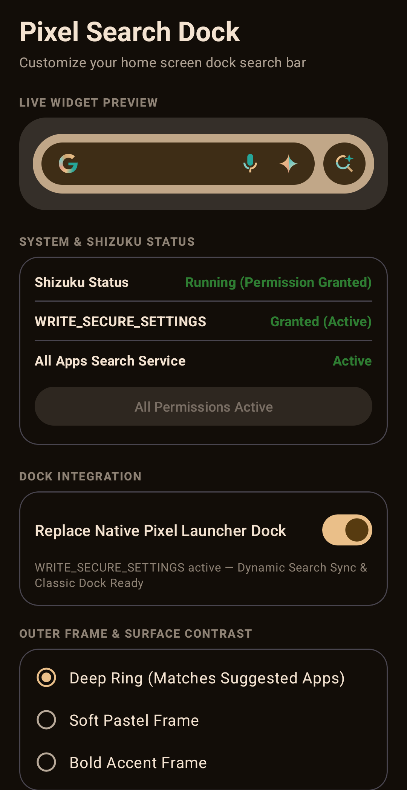

# ClassicPixelSearch

A native Android dock search widget for Google Pixel devices (Pixel Launcher) that restores the classic rounded Google Search bar with real-time OneSearch synchronization via Shizuku / Accessibility Service.

[](LICENSE)
[](https://developer.android.com)
[](https://github.com/Nornthenight/ClassicPixelSearch/releases)

---

## Visual Showcase

### Dynamic Dock Frame Adaptation (Day & Night)
The search pill dynamically matches your wallpaper and Pixel Launcher's light/dark system theme with pixel-perfect elevation, corner radii, and icon colors.

| Light Mode Dock | Dark Mode Dock |
| :---: | :---: |
|  |  |
| *Pixel Launcher light dock bar with dynamic accent tinting* | *Pixel Launcher dark dock bar with night contrast adaptation* |

<br/>

### OneSearch QuickLaunch & In-App Management

| All Apps OneSearch + Enter QuickLaunch | Settings & Shizuku Integration |
| :---: | :---: |
|  |  |
| *Typing queries in All Apps highlights top matched apps with instant Enter key launch.* | *Real-time Shizuku status indicator and interactive widget customization preview.* |

---

## Key Features

- **Pixel Launcher Aesthetic & Micro-interactions**:
  - Classic rounded pill search bar with Google "G" logo, Mic, Lens, and Gemini / AI Mode buttons.
  - Pixel 8 / Pixel 9 dynamic color palette synchronization (Default Light/Dark, Pastel, and Rich variants).
  - Authentic touch ripples, elevation shadows, and dock padding matching Pixel Launcher specifications.
- **Smart Launcher OneSearch Synchronization**:
  - **Real-Time Drawer Sync**: Monitors foreground transitions to automatically invoke Pixel Launcher's native All Apps drawer search (`com.google.android.apps.nexuslauncher`).
  - **Enter QuickLaunch**: Typing an app name highlights the best candidate and launches it immediately on pressing Enter (Keyevent 66).
- **Dual-Engine Operation (Shizuku + Accessibility)**:
  - **Shizuku Integration**: High-performance, low-overhead window state detection without requiring root.
  - **Accessibility Fallback (`LauncherStateService`)**: Ensures uninterrupted synchronization even if Shizuku is not running.
- **Quick Tap Actions**:
  - Direct intent dispatches for Google Search (`SearchTapActivity`), Assistant / Gemini AI, Google Voice Search, and Google Lens.
- **Customizable In-App Preferences**:
  - Live preview card to test your configuration before placing widgets.
  - Toggle AI Mode icon, voice search microphone, Google Lens icon, and theme palettes.

---

## Tech Stack

- **Language**: Kotlin 2.0+
- **Build System**: Gradle 8.9 (Kotlin DSL `build.gradle.kts`)
- **Min SDK**: Android 14 (API 34)
- **Target SDK**: Android 15 (API 35)
- **Core Dependencies**:
  - AndroidX Core KTX, AppCompat, Material Components
  - Shizuku API (`rikka.shizuku:api`, `rikka.shizuku:provider`)

---

## Installation & Setup

### 1. Download & Install
Download the latest `pixelbar.apk` from the [GitHub Releases](https://github.com/Nornthenight/ClassicPixelSearch/releases) page and install it on your device.

```bash
# Or install via ADB
adb install -r pixelbar.apk
```

### 2. Configure Permissions
1. Open the **Pixel Classic Search** settings app from your app drawer.
2. **Authorize Shizuku** (Recommended): Tap *Authorize Shizuku* if you have Shizuku running for zero-latency background synchronization.
3. **Accessibility Fallback**: If Shizuku is not active, enable the **Pixel Launcher Synchronizer** accessibility service in Android Settings.

### 3. Add the Dock Widget
Long press on your home screen or dock, tap **Widgets**, find **Pixel Classic Search**, and drag the widget onto your dock or home screen.

---

## Building from Source

```bash
# Clone the repository
git clone https://github.com/Nornthenight/ClassicPixelSearch.git
cd ClassicPixelSearch

# Build the release APK
./gradlew assembleRelease

# Or build debug APK
./gradlew assembleDebug
```

---

## License

Distributed under the Apache License, Version 2.0. See [LICENSE](LICENSE) for details.
