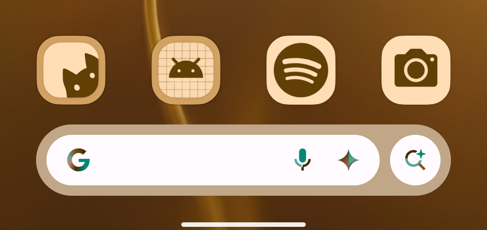
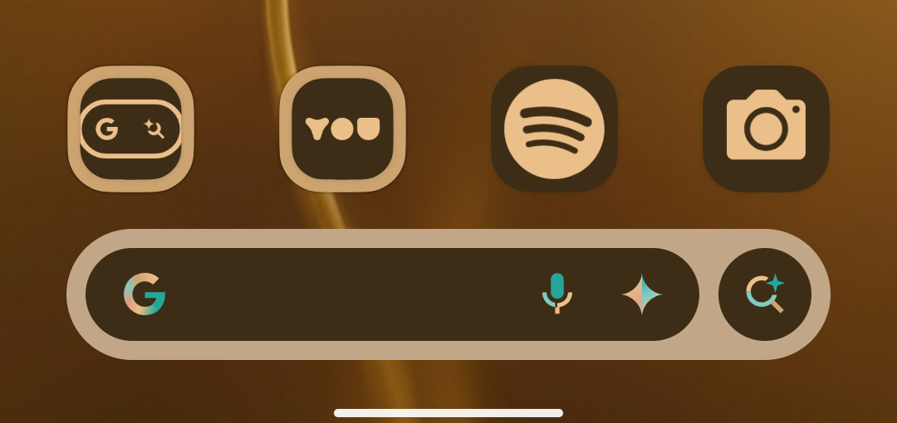
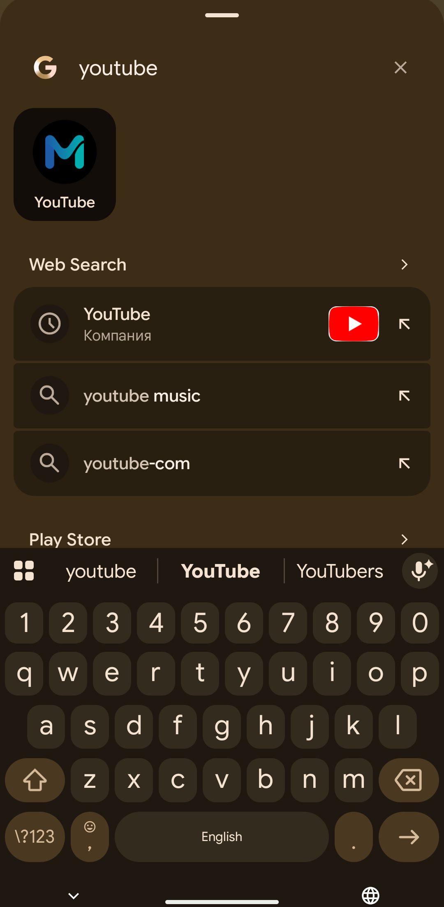
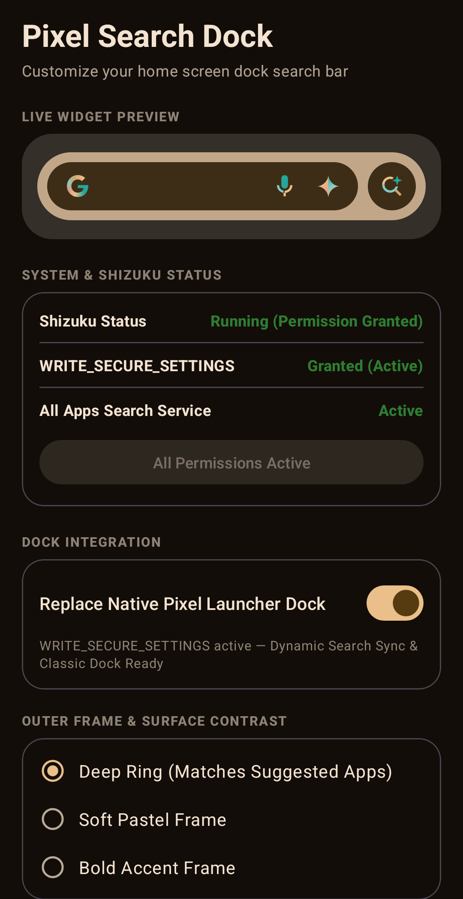

# ClassicPixelSearch

A native Android dock search widget for Google Pixel devices (Pixel Launcher) that replaces the bottom home screen search dock with the classic concentric double-frame search bar, featuring real-time Material You Monet dynamic color synchronization (wallpaper & palette changes) and Shizuku-assisted setup.

[](LICENSE)
[](https://developer.android.com)
[](https://github.com/Nornthenight/ClassicPixelSearch/releases)

---

## Visual Showcase

### Dynamic Dock Frame Adaptation (Day & Night)
The search pill dynamically matches your wallpaper and Pixel Launcher's light/dark system theme with pixel-perfect elevation, corner radii, and icon colors.

| Light Mode Dock | Dark Mode Dock |
| :---: | :---: |
|  |  |
| *Pixel Launcher light dock bar with dynamic accent tinting* | *Pixel Launcher dark dock bar with night contrast adaptation* |

<br/>

### OneSearch QuickLaunch & In-App Management

| All Apps OneSearch + Enter QuickLaunch | Settings & Shizuku Integration |
| :---: | :---: |
|  |  |
| *Typing queries in All Apps highlights top matched apps with instant Enter key launch.* | *Real-time Shizuku status indicator and interactive widget customization preview.* |

---

## Key Features

- **Pixel Launcher Aesthetic & Micro-interactions**:
  - Classic rounded pill search bar with Google "G" logo, Mic, Gemini / Lens, and AI Mode buttons.
  - Dynamic Material You / Monet color palette synchronization (Deep Ring, Soft Pastel, Bold Accent, and **Pure AMOLED Black / High Contrast**).
  - Pixel-style haptic feedback (`CLOCK_TICK` or `CONTEXT_CLICK`) on search capsule and icon taps.
- **Fine-Grained Geometry & Framing Controls**:
  - Independent sliders for **Outer Ring Opacity (`0–100%`)**, **Concentric Ring Gap (`2–12 dp`)**, and **Corner Radius (`12–36 dp`)** to fit `4x5` and `5x5` desktop grids.
- **Custom Right-Zone Button Remapping**:
  - Assign custom actions to the Microphone, Middle (Gemini/Lens), and Right (AI Circle) buttons: Google Voice Search, Gemini, Google Lens, Google AI Mode (`udm=50`), ChatGPT, Perplexity, System QR Code Scanner, Brave, Firefox, Cromite, or **any installed application**.
- **Seamless Dock Integration (Shizuku + Accessibility)**:
  - **Shizuku Integration**: One-tap `WRITE_SECURE_SETTINGS` grant to mount the widget directly inside Pixel Launcher's bottom search dock (`selected_search_engine`).
  - **Wallpaper & Monet Sync (`LauncherStateService`)**: Automatically refreshes widget colors when the wallpaper or dynamic theme changes.

---

## Tech Stack

- **Language**: Kotlin 2.0+
- **Build System**: Gradle 8.9 (Kotlin DSL `build.gradle.kts`)
- **Min SDK**: Android 12 (API 31)
- **Target SDK**: Android 15 (API 35)
- **Core Dependencies**:
  - AndroidX Core KTX, AppCompat, Material Components
  - Shizuku API (`rikka.shizuku:api`, `rikka.shizuku:provider`)

---

## Installation & Setup

### 1. Download & Install
Download the latest stable (`v1.2.1`) or beta (`v1.3-beta`) APK from [GitHub Releases](https://github.com/Nornthenight/ClassicPixelSearch/releases) and install it on your Pixel phone or Pixel Tablet:

```bash
# Install v1.3-beta via ADB
adb install -r ClassicPixelSearch-v1.3-beta.apk
```

### 2. Configure Permissions
1. Open the **Pixel Classic Search** settings app from your app drawer.
2. **Authorize Shizuku** (Recommended): Tap *Authorize Shizuku* if you have Shizuku running for zero-latency background synchronization.
3. **Accessibility Fallback**: If Shizuku is not active, enable the **Pixel Launcher Synchronizer** accessibility service in Android Settings.

### 3. Add the Dock Widget
Long press on your home screen or dock, tap **Widgets**, find **Pixel Classic Search**, and drag the widget onto your dock or home screen.

---

## Building from Source

```bash
# Clone the repository
git clone https://github.com/Nornthenight/ClassicPixelSearch.git
cd ClassicPixelSearch

# Build the release APK
./gradlew assembleRelease

# Or build debug APK
./gradlew assembleDebug
```

---

## License

Distributed under the Apache License, Version 2.0. See [LICENSE](LICENSE) for details.
